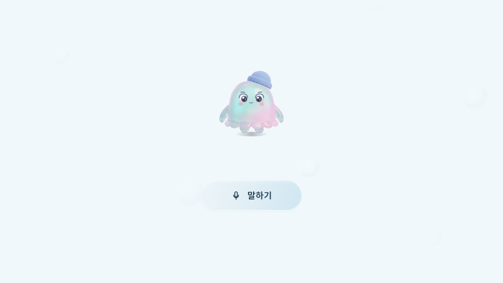
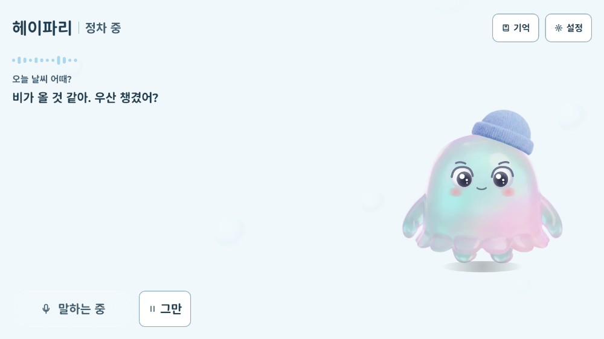
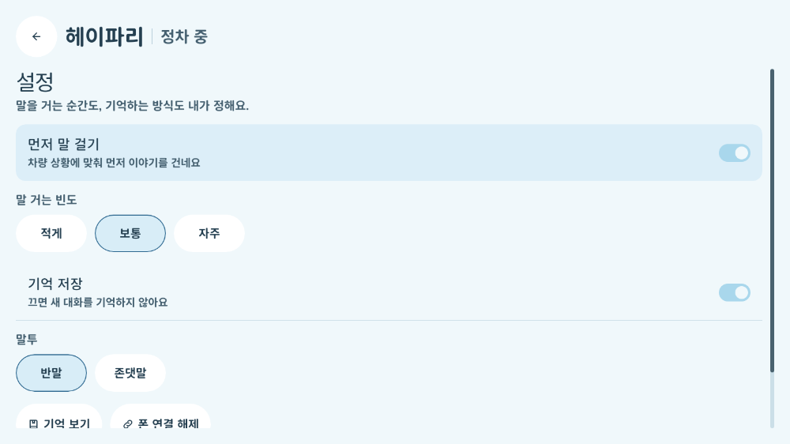

<p align="center">
  
</p>

<h1 align="center">Hey 차량 앱</h1>

<p align="center">
  차 안에 사는 캐릭터 AI 친구 "헤이리"의 Pleos 차량 앱.<br>
  음성으로 대화하고, 차량 상태를 읽어 먼저 말을 걸고, 나를 기억합니다.
</p>

<p align="center">
  
  
  
</p>

Team Hey가 만든 Pleos(Android Automotive) 차량용 앱입니다. 패키지는 `ai.hey.car`, minSdk 28 / targetSdk 34입니다. 위 화면은 Paparazzi 스냅숏입니다(홈, 대화, 설정).

## 주요 기능

- **음성 대화**: 차량의 온디바이스 음성 인식(Pleos STT)으로 듣고, 서버가 만든 답과 캐릭터 목소리로 말합니다. 서버 음성이 없으면 Pleos TTS가 읽습니다.
- **먼저 말 걸기**: 주행 상태·기어·문·내비 목적지까지 남은 거리를 읽고, 새로운 일이 생기면 먼저 말을 겁니다. 빈도는 설정에서 고릅니다.
- **기억**: 대화에서 기억한 것을 화면에서 보고 지울 수 있습니다.
- **친구**: 친구 코드로 연결해 친구의 메시지를 읽어 줍니다.
- **폰 연결**: 설정에서 QR로 폰 앱과 연결합니다.
- **운전 중 화면**: 주행 중에는 음성만 쓰고 화면은 큰 글자·큰 버튼(76dp 이상, 주요 동작 96dp)으로 단순하게 둡니다.
- **분할 화면**: 1600×900dp 기준 화면을 창 너비에 맞춰 늘이고 줄이며, 내비 옆 분할(840dp, 560dp)도 지원합니다.

## 구조

| 모듈 | 내용 |
|---|---|
| `app` | `MainActivity`, 서비스, 의존성 연결 |
| `core/vehicle` | Pleos 차량 게이트웨이, Pleos TTS·STT, 음성 큐(`SpeechQueue`) |
| `core/session` | 서버 `/v1/talk` 클라이언트(등록 → 세션 → WebSocket, 재연결 1·2·4·8·15초) |
| `core/designsystem` | Compose 부품, 테마, 부품별 스냅숏 시험 |
| `core/model` | 설정·메시지 모델 |
| `feature/home` | 홈, 대화, 주행 중 화면, 캐릭터 |
| `feature/onboarding` | 첫 실행 안내 |
| `feature/memory` | 기억 보기·지우기 |
| `feature/settings` | 설정, 친구, 폰 연결 |
| `shared/` | [companion-shared](https://github.com/teamhey-challenge/companion-shared) 서브모듈(디자인 토큰, 프로토콜) |

화면 모듈은 디자인 시스템 부품만 씁니다. 원시 위젯과 색·크기 리터럴을 쓰면 `checkDesignSystemUsage`가 빌드를 실패시킵니다.

## 사용한 Pleos SDK

`ai.pleos.playground` 라이브러리를 씁니다. 버전은 `gradle/libs.versions.toml`에 있습니다.

| SDK | 쓰는 곳 |
|---|---|
| Vehicle | 주행 상태·기어·문 등 차량 신호 읽기 |
| NaviHelper | 목적지 유무, 남은 거리, 도착 이벤트 |
| SpeechToText | 음성 인식(ON_DEVICE, `Locale.KOREA`) |
| TextToSpeech | 서버 음성이 없을 때 답을 읽기 |

SDK 파일은 이 저장소에 없고, 빌드할 때 Pleos Playground 저장소에서 받습니다. 받으려면 Playground 계정과 이용약관 동의가 필요합니다. 자세한 내용은 [THIRD_PARTY.md](THIRD_PARTY.md)를 보세요.

## 빌드와 실행

필요한 것: JDK 17, Android SDK(compileSdk 36), Pleos Playground 접근 권한. Android Studio 없이도 빌드됩니다.

```sh
git clone --recurse-submodules https://github.com/teamhey-challenge/companion-car.git
cd companion-car
./gradlew :app:assembleDebug     # 디버그 APK: app/build/outputs/apk/debug/app-debug.apk
./gradlew :app:assembleRelease   # 릴리스 APK
```

서브모듈 없이 클론했다면 `git submodule update --init`을 먼저 실행하세요.

실행은 Pleos Connect 에뮬레이터 `pleos_connect_v2_1`(Android Automotive)에서 확인했습니다. 설치 뒤 앱 목록에서 Hey를 엽니다.

```sh
adb install -r app/build/outputs/apk/debug/app-debug.apk
```

서버 주소를 바꾸려면 `-PserverUrl=https://...`를 붙입니다(https만 허용). 마이크가 없는 환경에서는 디버그 빌드의 텍스트 주입(`DemoVoice`)으로 음성 입력을 대신합니다. 릴리스 빌드에는 이 경로가 없습니다.

## 테스트

```sh
./check.sh                        # 조립 + 단위 시험 + 디자인 시스템 검사 + 스냅숏 검증
./gradlew :core:session:test      # 한 모듈만
```

- 단위 시험: 서버 연결·재연결, 음성 큐, 온보딩 흐름, 설정·친구·기억 화면 상태.
- 스냅숏: [Paparazzi](https://github.com/cashapp/paparazzi)로 화면 상태마다 라이트·다크, 폭 1600·1251·840·560dp를 찍어 `*/src/test/snapshots/images/`와 비교합니다. 기준 이미지는 CI의 `record-snapshots` 워크플로가 만들며 로컬에서 기록하지 않습니다.
- CI(`.github/workflows/ci.yml`)는 main에서 같은 `./check.sh`를 돌립니다.

## APK

| 항목 | 위치 |
|---|---|
| 제출용 릴리스 APK | [`apk/TeamHey_Hey_release.apk`](apk/TeamHey_Hey_release.apk) |
| 최신 APK | https://hey.lastmile.ltd/download/latest.apk |
| 파일 목록과 SHA-256 | https://hey.lastmile.ltd/download/ |

폰 앱은 [companion-phone](https://github.com/teamhey-challenge/companion-phone)에 있습니다.

## 서버

기본 서버는 `https://hey.lastmile.ltd/api`입니다. 서버 코드는 [companion-server](https://github.com/teamhey-challenge/companion-server), 폰 웹은 [companion-web](https://github.com/teamhey-challenge/companion-web)에 있습니다.

## 개인정보

- 음성 인식은 차량 안에서 처리됩니다. 마이크 오디오는 서버로 보내지 않고 인식된 문장 글자만 보냅니다.
- 내비 좌표는 저장하지 않습니다. "목적지가 있는가" 판단에만 쓰고, 서버에는 남은 거리(km)와 목적지 이름만 보냅니다.
- 기억은 사용자가 보고 지울 수 있습니다.

전체 안내: https://hey.lastmile.ltd/privacy

## 라이선스

코드는 [MIT](LICENSE)입니다. 글꼴·SDK·런타임 고지는 [THIRD_PARTY.md](THIRD_PARTY.md)를 보세요. Pleos SDK에는 MIT가 적용되지 않고 Playground 이용약관을 따릅니다.
